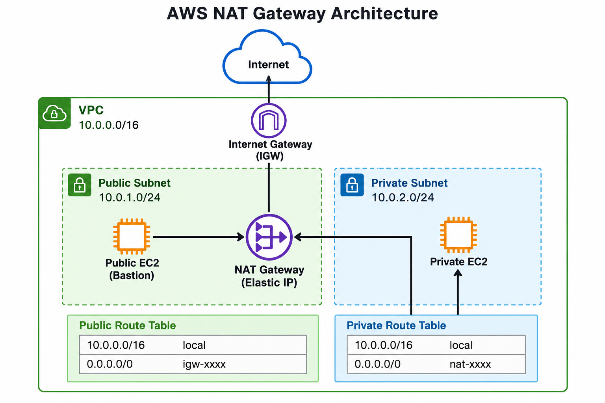

# AWS NAT Gateway Project

A hands-on AWS CLI lab to provide **outbound internet access for a private EC2 instance** through a public NAT Gateway. A public EC2 instance serves as the SSH bastion.

[View full-size architecture](NAT-GW.png)

## Network design

| Resource | Configuration |
|---|---|
| AWS Region | `us-east-1` |
| VPC | `10.0.0.0/16` |
| Public subnet | `10.0.1.0/24` → Internet Gateway |
| Private subnet | `10.0.2.0/24` → NAT Gateway |
| EC2 instances | Public bastion + private workload (Amazon Linux 2023) |
| NAT Gateway | Public subnet with Elastic IP |

## Project guide

1. **[Deploy the infrastructure](docs/01-Deployment.md)** — prerequisites, VPC, subnets, IGW, routes, NAT, security groups, and EC2 commands.
2. **[Connect and test](docs/02-Testing.md)** — bastion SSH, NAT egress IP, routing, and live verification checklist.
3. **[Clean up AWS resources](docs/03-Cleanup.md)** — terminate instances and remove billable infrastructure in dependency order.
4. **[Key concepts and references](docs/04-Reference.md)** — networking points to remember and official AWS documentation.

## Expected outcome

- Private EC2 has **no public IPv4 address**.
- Private EC2 can access HTTPS endpoints and install packages through the NAT Gateway.
- Its observed outbound public IP matches the NAT Gateway Elastic IP.
- SSH to the private EC2 uses the public bastion host.

## Verification status

**Documentation reviewed; live AWS deployment not executed.** Results in the [testing guide](docs/02-Testing.md) remain pending until verified in an AWS account.

> **Cost notice:** NAT Gateway, EC2 instances, and public IPv4 addresses may incur charges. Follow the [cleanup guide](docs/03-Cleanup.md) when finished. This is a single-AZ teaching lab, not a highly available production design.

## Documentation / Wiki

The `docs/` directory is a **wiki-style guide stored in this repository**. GitHub's separate Wiki feature is not yet populated; these pages are version-controlled and accessible directly from the links above.
